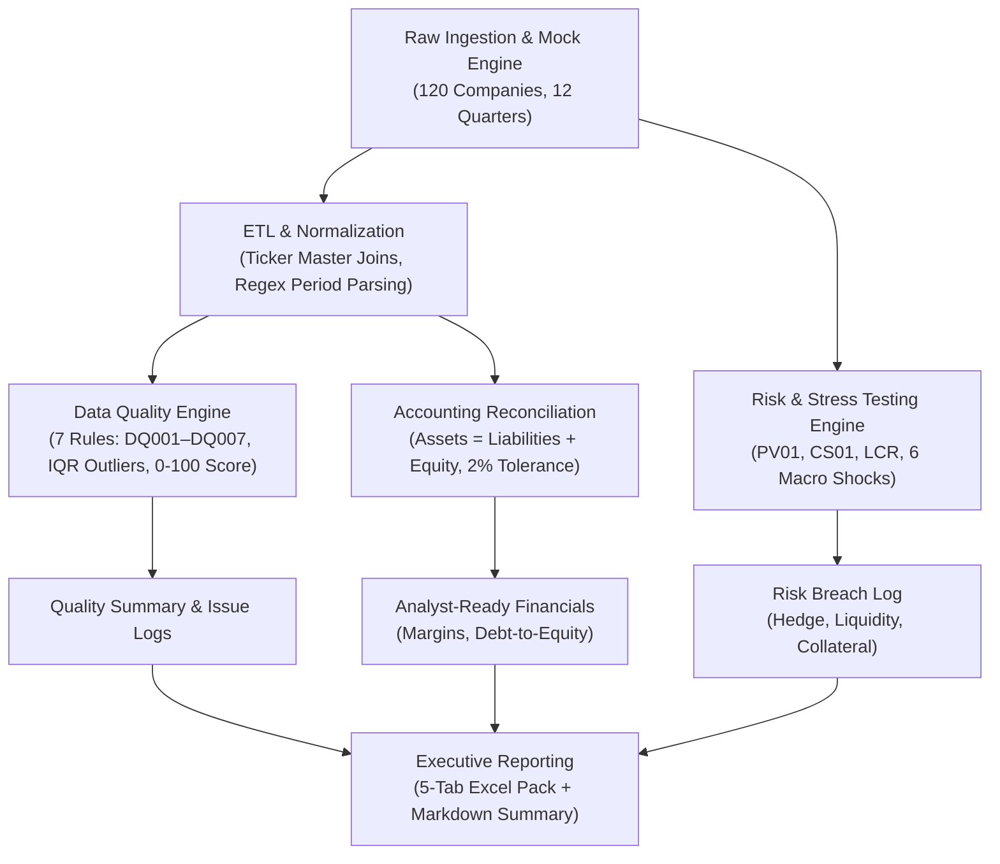

# SentinETL — Automated Financial Reconciliation & Risk Analytics Engine

[](https://www.python.org/)
[](https://pandas.pydata.org/)
[](https://docs.pytest.org/)
[](LICENSE)

An end-to-end financial data management, ETL, and automated risk monitoring pipeline designed to ingest, validate, reconcile, and stress-test multi-period financial fundamentals across 120+ corporate entities. 

The engine models clean, fit-for-purpose datasets for downstream research and generates executive-ready audit tables, compliance breach logs, and multi-tab risk scenario packs.

---

## Highlights & Key Accomplishments

* **Automated Data Quality Assessment:** Accomplished automated financial data ingestion and quality assessment across 1,400+ quarterly records for 120 companies, as measured by a 7-rule validation suite and 0–100 data health scores, by engineering a Python ETL pipeline that profiled missing values, resolved ticker mappings, and screened outliers using IQR statistics.
* **Accounting Reconciliation Engine:** Accomplished balance sheet reconciliation and financial data modeling across 12 fiscal periods, as measured by catching accounting discrepancies beyond a 2% tolerance threshold, by building an automated validation module that generated clean, fit-for-purpose datasets enriched with key financial ratios.
* **Multi-Dataset Portfolio Stress Testing:** Accomplished multi-dataset portfolio stress testing across 6 macroeconomic market shock scenarios, as measured by automated compliance breach tracking across interest rate, liquidity, and collateral metrics, by designing an analytics engine that delivered audit-ready logs and 5-sheet executive Excel reports.

---

## Tech Stack

* **Core Language:** Python 3.10+
* **Data Ingestion & Modeling:** Pandas, NumPy
* **Data Quality & Validation:** Statistical Outlier Screening (IQR), Regular Expressions (Regex), Reference Master Joins
* **Financial Modeling & Risk Analytics:** Balance Sheet Reconciliation, PV01 / CS01 Sensitivity, Liquidity Coverage Ratio (LCR), Macro Stress Scenarios
* **Testing & Quality Assurance:** Pytest
* **Reporting & Delivery:** OpenPyXL (5-Sheet Excel Pack), CSV Audit Logs, Markdown Summaries

---

## Pipeline Architecture



---

## Project Structure

```text
SentinETL/
├── main.py                  # CLI orchestrator for pipeline execution
├── requirements.txt         # Dependencies (pandas, numpy, openpyxl, pytest, tabulate)
├── README.md                # Project documentation
├── src/
│   ├── config.py            # Centralized dynamic path management
│   ├── data_generator.py    # Multi-period generator & realistic flaw injection
│   ├── etl.py               # Ingestion, normalization, and ticker master resolution
│   ├── data_quality.py      # 7-rule validation suite & 0-100 scoring engine
│   ├── reconciliation.py    # Accounting equation validator & analyst ratio modeling
│   ├── risk_analytics.py    # PV01/CS01 risk metrics, 6 stress scenarios & breach logs
│   └── reporting.py         # 5-sheet Excel workbook & markdown report generation
├── data/
│   ├── raw/                 # Unprocessed financial statements & exposures
│   ├── reference/           # Master ticker & sector reference tables
│   └── processed/           # Cleaned & normalized intermediate data
├── outputs/                 # Final audit tables, breach logs, and executive packs
└── tests/                   # Automated Pytest suite
```

---

## Core Validation & Audit Rules

| Rule ID | Severity | Category | Description |
|---|---|---|---|
| **DQ001** | High | Completeness | Required field is missing or null |
| **DQ002** | High | Validity | Negative balance sheet values (Total Assets / Liabilities < 0) |
| **DQ003** | Medium | Consistency | Gross margin falls outside expected review range (-20% to 90%) |
| **DQ004** | High | Uniqueness | Duplicated company-period records |
| **DQ005** | Medium | Accuracy | Statistical outlier detected using 3.0x IQR screening |
| **DQ006** | Medium | Completeness | Company has fewer than 10 quarters of historical data |
| **DQ007** | Medium | Consistency | Quarter-on-quarter revenue movement exceeds ±250% |
| **RECON** | High / Review | Accounting | Assets $\neq$ Liabilities + Equity (> 2% variance) |

---

## Getting Started

### 1. Prerequisites & Environment Setup

```bash
git clone https://github.com/Shivam-Singh-1/SentinETL.git
cd SentinETL

# Create and activate virtual environment
python -m venv .venv
source .venv/bin/activate       # On Windows: .venv\Scripts\activate

# Install dependencies
pip install -r requirements.txt
```

### 2. Run the Full Pipeline

```bash
python main.py --run-all
```

This single command will:
1. Ingest raw fundamentals and master reference data.
2. Execute data cleaning, normalization, and ticker mapping.
3. Run the 7-rule data quality audit and compute 0–100 company scores.
4. Reconcile the accounting equation and export the analyst-ready dataset.
5. Simulate 6 macro stress scenarios and generate compliance breach logs.
6. Export the 5-sheet management Excel pack and Markdown executive summary to `outputs/`.

### 3. Run Test Suite

```bash
pytest -q
```

---

## Generated Outputs (`outputs/`)

| Output File | Purpose |
|---|---|
| `management_report.xlsx` | 5-tab executive report (DQ Summary, DQ Issues, Recon, Scenarios, Breaches) |
| `analyst_ready_financials.csv` | Clean, standardized dataset enriched with core financial ratios |
| `reconciliation_audit_table.csv` | Accounting balance equation audit differences and pass/review flags |
| `data_quality_issue_log.csv` | Row-level audit trail for all validation rule exceptions |
| `data_quality_summary.csv` | Company-level health scores (0–100) and issue tallies |
| `risk_scenario_report.csv` | Macro stress P&L, PV01 gaps, and stressed collateral metrics |
| `risk_breach_log.csv` | Compliance breach log for hedge, liquidity, and collateral violations |
| `management_summary.md` | Executive-level markdown dashboard |

---

## License

This project is licensed under the MIT License.
